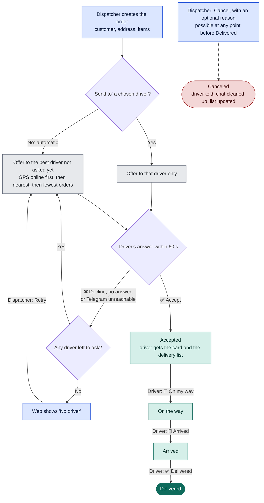
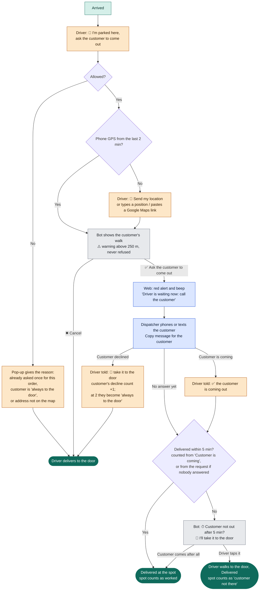
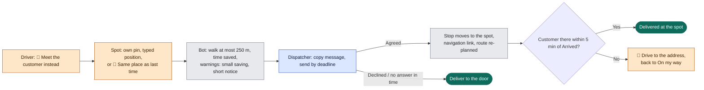

# Order journey after Plan 4

Every path an order can take on the live system once Plan 4 is merged, from the moment the dispatcher creates it
until it's delivered or canceled, and who does what at each point. Written 2026-10-29 for the review before the
merge.

Live settings this describes: `ROUTE_OPTIMIZATION` off · `MEETING_POINTS=parked` (only "I'm parked here") · offers
answered within 60 s · no automatic "deliver by" (`MAX_WAIT_MINUTES=0`).

In the flowcharts: orange = driver (Telegram), blue = dispatcher (web), grey = the app by itself, green = order
status.

## 1. From new order to delivered or canceled

The main path. Every order goes through it; the other scenarios are detours along the way.

- Only active drivers who connected Telegram are offered orders. Each driver is asked at most once per round;
  **Retry** starts a new round.
- While an order waits, the web shows who is deciding and the seconds left. "No driver" appears once nobody is left.
- With route optimization off (live), the driver's list is nearest first and every accepted order has
  **On my way**.

## 2. While the order is being delivered

What each side can do at each status. None of this changes the main path; it runs alongside it.

| Status | Driver can | Dispatcher can | The app does |
|---|---|---|---|
| Waiting for driver | Accept or decline the offer | Edit the order (the deciding driver sees the new details) · Retry after "No driver" · Cancel | Moves to the next driver after 60 s |
| Accepted | 🚚 On my way · `/orders` for the list | Ask driver for ETA · Edit (driver told; a new address re-sorts the list) · Cancel | Sends the delivery list again when stops change |
| On the way | ⏱ 2 / 3 / 5 min when close · answer an ETA question (3 / 5 / 7 / 10+) | Gets an orange "arrives at ~14:05: contact the customer" alert · Ask for ETA · Edit · Cancel | — |
| Arrived | ✏️ Report a change (new quantities apply at once, or a written note) · 📌 I'm parked here (section 3) · ✅ Delivered | Edit the order or **Mark as handled** for a written change (driver told) · OK for applied quantities · Cancel | Alerts the dispatcher about every change report |
| Delivered | — | Correct the items only, e.g. if the driver tapped Delivered instead of reporting a change (recorded, driver not messaged) | Deletes the order's extra messages from the driver's chat; sends a fresh list |
| Canceled | — | — | Driver gets one cancel notice with the details; other messages about it are deleted |

## 3. "I'm parked here, ask the customer to come out" (new with Plan 4)

The only meeting-point feature switched on for live. It appears on the card once the driver taps **📍 Arrived**,
and can be used once per order.

- The ready-made customer message reads like: "Hi Jane, your driver is here now with your delivery (order #52),
  parked at Queens Road, about 3 min walk (220 m) from your address: *map link* . Could you come out to meet
  them? They'll wait about 5 minutes."
- If the dispatcher answers **Customer is coming** after the bot already asked "Customer not out?", the bot waits
  another 5 minutes and asks again.
- The customer page has **Always deliver to the door**: on after 2 declines (including "I'm parked here"
  declines), or set by hand. Turning it off resets the count.
- Canceling the order while a request is open simply removes the request; the driver gets the normal cancel
  notice.

## 4. "Meet the customer instead" (built, switched off on live)

Switched on only with `MEETING_POINTS=all`. For reference, the path it adds on any upcoming stop:

## 5. Every button, and who presses it

| Who | Button or action | When it's there | What happens |
|---|---|---|---|
| Driver | ✅ Accept / ❌ Decline | New offer, 60 s | Accept: the order is theirs. Decline or silence: next driver |
| Driver | 🚚 On my way | Accepted | Status On the way; ETA buttons appear |
| Driver | ⏱ 2 / 3 / 5 min | On the way | Dispatcher alerted to contact the customer |
| Driver | 📍 Arrived | On the way | Status Arrived; Report a change and I'm parked here appear |
| Driver | ✏️ Report a change | Arrived | New quantities apply at once, or a note goes to the dispatcher |
| Driver | 📌 I'm parked here | Arrived, once per order | Section 3 |
| Driver | 🚪 I'll take it to the door | 5 min after the request or after "Customer is coming" | Recorded as customer not there |
| Driver | ✅ Delivered | Arrived | Order finished, chat cleaned up |
| Dispatcher | Send to / Retry / Cancel | Waiting for driver | Choose the driver, ask everyone again, or stop |
| Dispatcher | Ask driver for ETA | Accepted to Arrived | Driver gets 3 / 5 / 7 / 10+ min buttons |
| Dispatcher | Edit order | Until Delivered (items only after) | Driver gets the new details |
| Dispatcher | Copy message / Customer is coming / Customer declined | "I'm parked here" request open | Driver told in Telegram |
| Dispatcher | Always deliver to the door | Customer page | Blocks "I'm parked here" requests for that customer |
